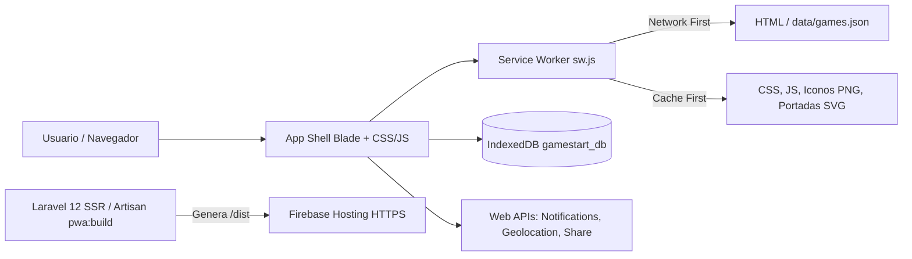

# GameStart — PWA de Videojuegos con Laravel y Firebase Hosting

Aplicación Web Progresiva (PWA) para explorar un catálogo de videojuegos, gestionar una biblioteca personal con notas offline y consultar capacidades nativas del dispositivo.

## Caso de Uso Práctico

**GameStart** resuelve el problema de consulta y seguimiento de videojuegos cuando el usuario no cuenta con conexión estable a internet:
- Exploración y filtrado rápido de títulos por género o plataforma.
- Guardado asíncrono de juegos, estados (*Por jugar*, *Jugando*, *Completado*) y notas personales en **IndexedDB**, disponibles sin conexión.
- Alertas locales mediante **Notifications API**, detección de tiendas/torneos cercanos con **Geolocation API** y botón de compartir con **Web Share API**.

## Arquitectura del Sistema



## Requisitos Cumplidos

1. **Instalabilidad**: `public/manifest.json` completo (`standalone`, `theme_color`, `background_color`, `screenshots`) e iconos PNG `192x192` y `512x512` (`any` y `maskable`), con captura de `beforeinstallprompt`.
2. **App Shell Responsivo**: Cabecera fija, navegación adaptativa (barra superior en escritorio e inferior en móvil) y separación entre estructura estática y contenido dinámico.
3. **Service Worker y Caché**: Registro limpio y manejo de `install`, `activate` (limpieza de cachés previas) y `fetch` con estrategias *Network First* y *Cache First*.
4. **Persistencia Offline**: Almacenamiento asíncrono en `IndexedDB` (`catalog` y `library`) con actualización inmediata de la interfaz.
5. **Web APIs Nativas**: Integración de *Notifications API*, *Geolocation API* y *Web Share API* con validación explícita de soporte y permisos.

## Credenciales y Flujo de Prueba

- **Acceso**: No requiere credenciales de inicio de sesión (acceso abierto para evaluación directa).
- **Instalación**: Abrir en Chrome/Edge, verificar en DevTools (*Application > Manifest*) y pulsar **Instalar App**.
- **Modo Offline**: Activar *Offline* en DevTools (*Network* o *Application > Service Workers*), recargar la página, filtrar el catálogo y crear/editar registros en **Mi Biblioteca**.
- **APIs Nativas**: Ir a **Radar Gaming**, autorizar notificaciones y detección de ubicación para comprobar el manejo de permisos y resultados.

## Instalación Local y Despliegue

```bash
# 1. Instalar dependencias de Laravel
composer install
cp .env.example .env
php artisan key:generate

# 2. Ejecutar servidor local SSR con Laravel
php artisan serve

# 3. Exportar compilado estático para Firebase Hosting
php artisan pwa:build

# 4. Desplegar con SSL/HTTPS en Firebase Hosting
firebase login --reauth
firebase use --add
firebase deploy --only hosting
```

## Publicación y Evidencia

- **URL de Producción (Firebase Hosting)**: *Pendiente de ejecutar `firebase deploy --only hosting` tras autenticar la CLI (`firebase login --reauth`).*
- **Repositorio Git**: `https://github.com/AngyUnU/GameStart.git`

### Capturas de Evidencia

> Agregar aquí las capturas finales tras el despliegue (Manifest sin errores, Service Worker activo, prueba Offline, IndexedDB y aplicación instalada).
