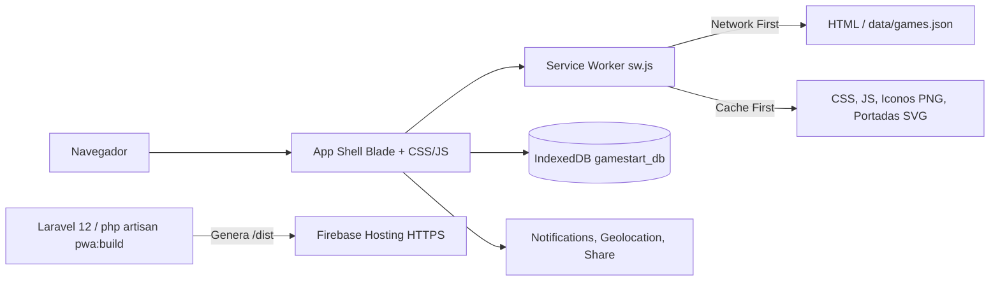

# GameStart — PWA de Videojuegos con Laravel y Firebase Hosting

Aplicación Web Progresiva (PWA) para explorar un catálogo de videojuegos, guardar favoritos offline y probar Web APIs nativas del dispositivo.

## Caso de Uso Práctico

**GameStart** permite consultar un catálogo de videojuegos, guardar títulos o notas personales en **IndexedDB** para revisarlos sin conexión, recibir alertas mediante **Notifications API**, consultar ubicación con **Geolocation API** y compartir con **Web Share API**.

## Arquitectura del Sistema



## Credenciales y Flujo de Prueba

- **Acceso**: No requiere credenciales (acceso abierto).
- **Instalación**: Abrir la URL publicada y pulsar **Instalar** (o desde el menú del navegador).
- **Modo Offline**: Activar *Offline* en DevTools, recargar la página y agregar o eliminar elementos en **Favoritos**.
- **Funciones Nativas**: Entrar a **Funciones**, conceder permisos de **Notificaciones** y **Ubicación GPS**.

## Instalación Local y Despliegue

```bash
composer install
cp .env.example .env
php artisan key:generate
php artisan serve

# Exportar compilado estático y desplegar en Firebase Hosting
php artisan pwa:build
firebase deploy --only hosting
```

## Publicación y Evidencia

- **URL de Producción (Firebase Hosting)**: https://actividad1-727e3.web.app
- **Repositorio Git**: https://github.com/AngyUnU/GameStart.git

### Capturas de Evidencia

Guarda tus capturas en una carpeta `evidencias/` en la raíz del proyecto y enlázalas así en Markdown:

```markdown


```
